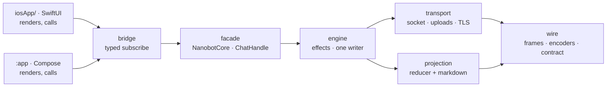

# HUMANS.md

The short version, for a human on a coffee break.

## What it is

A phone client for your own nanobot. You give it the address of your gateway
and the WebUI secret you already use in the browser, and it opens the same
socket the browser opens. Sessions in the drawer, a chat with streaming
answers, tool rows and diffs, attachments, voice notes, settings that tell the
truth about what a phone can actually do. Two native apps — SwiftUI and
Compose — over one shared Kotlin core that contains no UI at all.

No account, no companion server, nothing leaves your network.

## The shape

All of that is `:core`, pure Kotlin with no UI in it.

Flow: gateway socket → frames → the reducer → view state → both apps. The apps
contain only UI.

## How it's built

**1. The core is the product; the UIs are renderers.**
`core/src/commonMain/.../facade/NanobotCore.kt` exposes `StateFlow`s and
`suspend` commands; screens read one state and call one command. A branch
worth testing lives in a view model, never in a `View` — that is why the iOS
suite has 95 model tests and only 29 UI tests.

**2. One reducer, two feeds.**
`projection/ThreadReducer.kt` reduces socket frames and the gateway's stored
history page. That is the whole reason a reopened chat does not look different
from the one you were reading. The gateway's stored pages are compacted —
`stream_end.text` holds the answer, `reasoning_end.text` the reasoning — and
both land through the same code (D52).

**3. Writes are socket-only.**
Sending, stopping (`/stop`), switching model (`/model <preset>`), changing
access mode, transcribing: all frames. The only HTTP write in the whole client
is the token-gated attachment upload. That is the gateway's design, not ours.

**4. The bridge is one file per platform, and it is thin.**
`core/src/iosMain/.../bridge/CompanionBridge.kt` gives Swift a typed
`subscribe(flow)` instead of a Kotlin coroutines box, and `@Throws` on the
facade turns every failure into an `NSError` Swift can catch. Three wrappers,
counted and pinned by a header-shape test (D38).

**5. Errors are a taxonomy with copy attached.**
Eight transport failures, each with a key and a sentence, asserted by tests on
every platform (`ConnectionCopy.swift`, `app/.../connect/ConnectionCopy.kt`).
Adding a ninth `CoreError` will not compile until it has a state and a copy.

**6. The instruments are the quality bar.**
A 20-minute live session, a 30-minute soak, and a parity check that compares
what the CLI, iOS and Android each make of the *same stored chat*. They found
the reconnect bug and the dropped-attachment bug that the unit tests missed.

## Run it

- Gateway: `tools/nanobot-dev.sh start --lan` (throwaway, prints a LAN address),
  or point at your own — `https://your-gateway.example` in this case.
- Android: `./gradlew :app:installDebug`
- iOS simulator: `xcodebuild -scheme iosApp -destination 'platform=iOS Simulator,name=iPhone 17' test`
- iPhone: `tools/run-on-device.sh --local` (needs an Apple ID signed into Xcode first)

The connect screen wants the gateway address and its WebUI secret. Nothing is
typed on the phone by the scripts: they hand both to the app through its launch
environment.

## What this is not

- **No push.** The gateway has no APNs or FCM, so notifications are
  foreground-only and Settings says exactly that instead of hinting at more.
- **No background sync.** A reconnect replays history; between launches the app
  keeps a cache, not a queue.
- **Math and diagrams are not rendered.** The design artifact excludes them from
  v1, so the parser does not pretend.
- **Transcription is unproven end to end** on a gateway with no STT provider
  (the dev one has none): the round trip and the refusal are tested, the
  transcript is not (P8).
- **Self-signed TLS is unmeasured** (P7/P11): the policy and the Darwin/Android
  translation are tested, the handshake itself is not. Real certificates work —
  that path is exercised against `your-gateway.example`.
- **Search source chips carry no data yet**, and the drawer's Automations row is
  a placeholder until someone builds that surface (P12).
- The bundle id, iOS 17.0 and minSdk 26 are still placeholders.

## More

`AGENTS.md` holds the conventions, the twenty-odd paid-for gotchas and the
review/QA bar. `plan.md` is the plan this was built to, `GATES.md` the evidence,
and `docs/decisions.md` the reasoning behind every choice that was not obvious.
