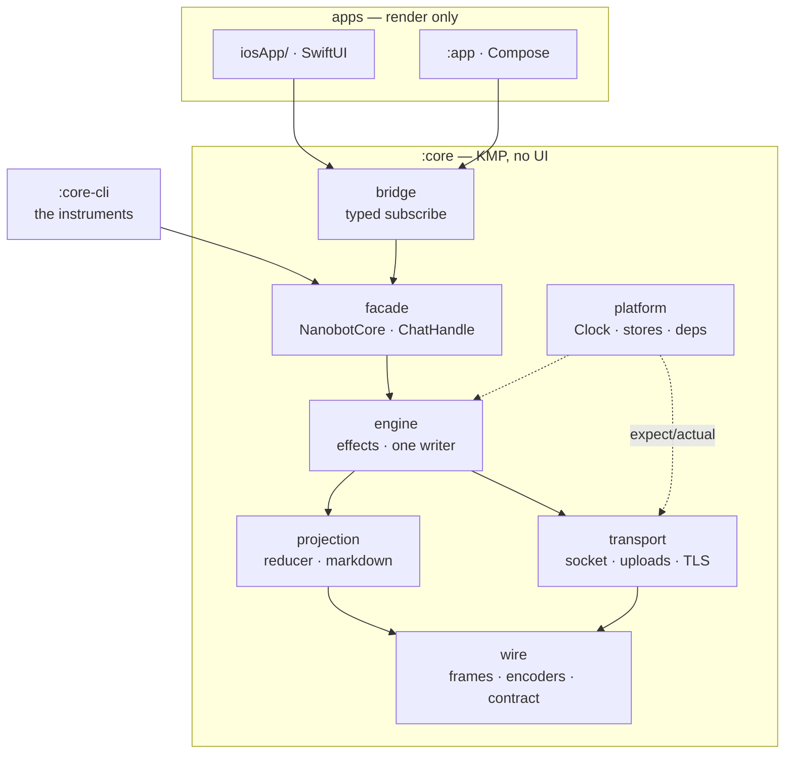
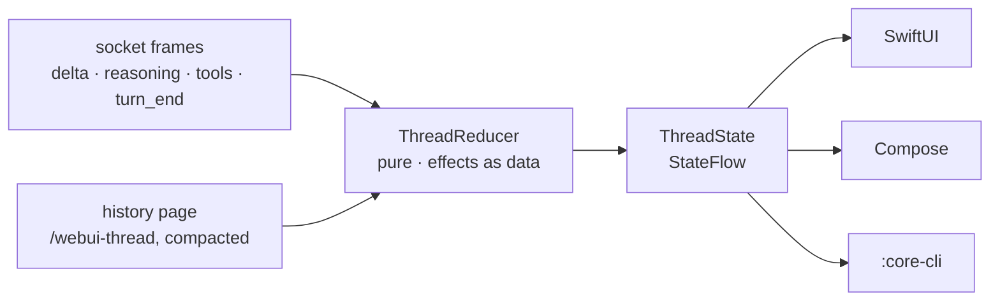

# nanobot Companion

A native iOS and Android client for a [nanobot](https://github.com/HKUDS/nanobot)
gateway. One Kotlin Multiplatform module holds everything that is not UI. iOS
renders it with SwiftUI, Android with Jetpack Compose, both against the
gateway's own WebSocket protocol, the same one the browser WebUI speaks.

**Not affiliated with HKUDS/nanobot.** This is an independent client for the
gateway that project publishes; the credits and licences for the artwork it
borrows are in [THIRD_PARTY_NOTICES.txt](THIRD_PARTY_NOTICES.txt).

The gateway is the product here, not the app's backend. There is no companion
server: the app authenticates to your nanobot with the WebUI secret, opens the
same socket the browser opens, and reduces the same frames. If the WebUI can
show it, the app can show it; if the gateway cannot do it, the app says so
instead of inventing a spinner.



The arrow is the dependency direction: nothing below points back up, and
`commonMain` never reaches for a UI toolkit (enforced by `ArchitectureTest`).

## What is hard here

- Two feeds, one reducer. The gateway replays the same event vocabulary for
  live frames and for stored history, so `:core` reduces both through
  `projection/ThreadReducer.kt`, and a chat reopened after a reconnect looks
  exactly like the chat you were reading. The stored pages are *compacted*:
  the answer text survives only inside `stream_end.text` and the reasoning
  inside `reasoning_end.text`.
- The protocol is the contract, and it is verified against the real thing.
  `-Pcontract` runs four tests against a live nanobot 0.4.1. Fixtures are
  recorded by `:core-cli record`, never hand-written, and carry provenance:
  gateway version, commit, redaction rules.
- Nothing here is allowed to be theatre. The architecture guard, the Kover
  floor and the parity instrument were each proved non-vacuous by breaking
  them. A test that passes with the implementation deleted is not a test;
  several tasks were rejected for exactly that.
- Both platforms are compared mechanically, not by eye.
  `tools/parity-check.sh` diffs the CLI's, iOS's and Android's reduction of the
  *same stored chat*, and compares nine error-copy keys across the two string
  tables.

One turn arrives twice, and both routes end in the same place:



## The gateway contract it depends on

| Piece | Where it comes from |
|---|---|
| `GET /webui/bootstrap` with `X-Nanobot-Auth: <secret>` → token, `ws_path`, `limits`, `terminal.webui` | `nanobot/webui/ws_http.py` |
| Protocol 1 + capability list (`terminal.webui.capabilities`) | `nanobot/webui/client_contract.py` |
| Socket frames: `ready`, `delta`, `reasoning_*`, `message`, `file_edit`, `turn_end`, `recovery_state`, … | `docs/websocket.md` in the gateway repo |
| History: `GET /api/sessions/{key}/webui-thread` | `nanobot/webui/transcript.py` |
| Writes: socket only, except token-gated `POST /api/attachments` | `nanobot/webui/ws_http.py` |

A bootstrap token is single-use, so every reconnect bootstraps again. The
engine obeys that rule; it is not a bug to paper over.

## Building and running

Prerequisites: JDK 21+, the Android SDK, Xcode 27 with an iOS 17+ runtime, and
a nanobot gateway you can reach.

```bash
./gradlew :core:allTests :core-cli:test :app:testDebugUnitTest   # all unit suites
./gradlew :app:installDebug                                      # Android on the emulator/device
tools/run-on-device.sh --local                                   # iOS on a plugged-in iPhone
```

The Xcode project is checked in as a hand-written `project.pbxproj`. The
framework arrives through a Run Script phase that calls
`./gradlew :core:embedAndSignAppleFrameworkForXcode`. No CocoaPods, no
XcodeGen, no Tuist.

For a gateway of your own:

```bash
tools/nanobot-dev.sh start --lan     # real nanobot, throwaway config, LAN address printed
tools/nanobot-dev.sh stop
```

It writes everything to `.dev/` (venv, config, secret, profile, logs) and
never touches `~/.nanobot`. Point the app at your own gateway or at that LAN
address; the secret is the gateway's WebUI secret.

## Testing

Counts are what the suites reported on 2026-11-17, read from `core/build/test-results/`,
`app/build/test-results/` and the Xcode `.xcresult` of a full run; re-read them the same way if you want to
know whether they are still true.

```bash
./gradlew :core:allTests                    # 444 jvm · 326 iOS sim · 312 android host
./gradlew :core:jvmTest -Pcontract          # against a live gateway (10 tests across three suites)
./gradlew :core:koverVerify                 # 85% floor on wire/projection/engine
./gradlew :app:testDebugUnitTest            # 173
./gradlew :app:connectedDebugAndroidTest    # 83 on the emulator
cd iosApp && xcodebuild -scheme iosApp -destination 'platform=iOS Simulator,name=iPhone 17' test
                                            # 210 swift-testing + 57 XCUITest
```

### What CI runs, and what it deliberately does not

GitHub Actions runs the parts that need nothing but a machine with a toolchain:

| job | what it proves |
|---|---|
| `test` (ubuntu) | `:core:testAndroidHostTest`, `:core-cli:test`, `:app:testDebugUnitTest`, and the copy parity check |
| `macos` | `:core:jvmTest` (it links the iOS framework before it runs), `:core:iosSimulatorArm64Test`, the coverage gate, and the XCUITest suite on a simulator |
| `connected` (advisory) | the Compose instrumented suite on an emulator. Advisory because the emulator's software keyboard can vanish and only a cold boot revives it |
| `builds` | the release APK, the AAB and the CLI zip, with the licence and third-party notices asserted inside each artefact |

**No secret is involved anywhere.** The five instruments that need a live gateway or a real device —
`:core:jvmTest -Pcontract`, `tools/parity-check.sh`, `tools/session20.sh`, `tools/soak.sh` and
`tools/android-session.sh` — never run on a hosted runner. They belong to a `self-hosted` runner on a machine
that has a gateway, and to a person who can watch them; running them against a hosted machine would either need
a gateway secret in CI or prove nothing.

Instruments that are not unit tests, and earn their keep:

- `tools/session20.sh`: 20-minute live session through the core (`beats=8, failures=0`)
- `tools/soak.sh`: 30 minutes, 200 sends, 50 reconnects, leak check
- `tools/android-session.sh`: the same beats on the emulator, through the app
- `tools/parity-check.sh`: CLI vs iOS vs Android transcript, plus error copy
- `tools/consult.sh`: ask clef, a decision model, to choose between two options

## Layout

```
core/                :core, the KMP library (no UI, no Compose, no UIKit)
core-cli/            :core-cli, the harness that talks to real gateways
app/                 :app, Jetpack Compose
iosApp/              SwiftUI + the Xcode project
tools/               dev gateway, devices, soak, parity, consultations
scripts/gate.sh      runs a phase checklist kept outside the repo; refuses to pass while a box is open
docs/diagrams/       the diagrams above, rendered to SVG (regenerate with mmdc)
```

The working record (plan, phase checklists, decision log, open questions) stays
outside the repository. It is how the work was tracked, not what the project
ships.

## How this was built

With an agent loop held to a written plan: TDD per task, one commit per task
with the failing run in the message, and phase gates that were only ticked after
the evidence had been re-run. Two gates were *held* rather than ticked because
the instruments found real defects: an app that did not replay history on
reconnect, and an iOS composer that silently dropped attachments. Both were
fixed with red-then-green tests.

`git log` is the durable record: one commit per task, each naming what it
changed and, where a red was weak, saying so. The plan, the checklists, the
decision log and the list of open questions were working files and are not
shipped.

## Licence

MIT, see [LICENSE](LICENSE). The work of the projects this app is built on or
copies from is in [THIRD_PARTY_NOTICES.txt](THIRD_PARTY_NOTICES.txt): nanobot's
MIT notice for the day/night mark and the product glyphs, Lucide's ISC plus the
Feather attribution for the seventeen WebUI icons the generator reads, Open
Sans' OFL, pele's MIT with the Lucide icon bundled inside it, the Apache-2.0
runtime set (Kotlin, kotlinx, Ktor, OkHttp/Okio, AndroidX and what Ktor pulls
in) and SLF4J's MIT. Both apps bundle those two files, so the text travels with
the binary rather than only with the repository.

## Notes for agents (and the curious)

`AGENTS.md` is the working guide: commands, the version matrix, twenty-odd
gotchas that were already paid for, and the review/QA bar. `HUMANS.md` is the
coffee-break version. The best code here is the code it does not contain: no
markdown library, no DI framework, no date library, no image loader, and one
third-party runtime dependency (Ktor, whose engines are the platforms' own).
